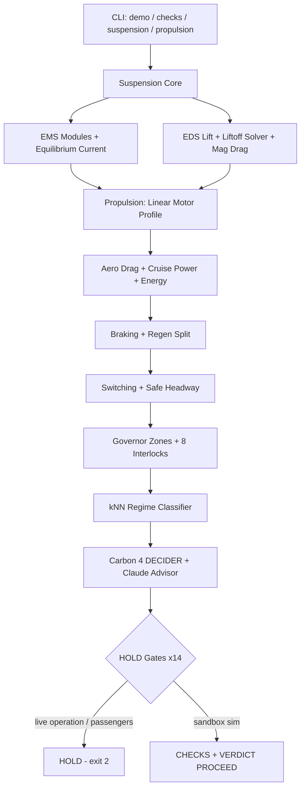
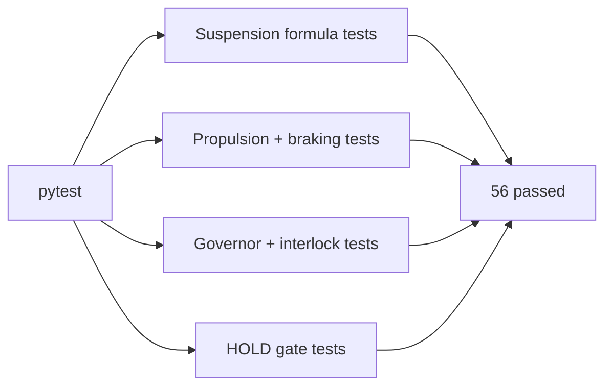
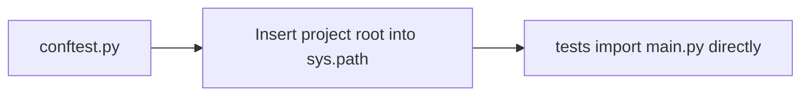
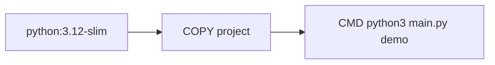

# MagLevX 🚄🧲

**Maglev Train Levitation Transport Lab** — by Darion Kellar

## ❓ What is this?

MagLevX is an **educational maglev train system lab** in ONE pure-Python file — the vehicle flagship that grows out of **LevitationX** physics. It takes the levitation formulas and scales them up to a full 240-tonne, 430 km/h trainset: **EMS vs EDS suspension** at train scale, **linear-motor propulsion** with a jerk-limited acceleration profile, **aerodynamic drag** and energy per passenger-km, **braking distances** from top speed, **guideway switching** and safe headway, X-family **speed governor zones**, **departure interlocks**, curve ride quality, and a TinyML regime classifier. 🚅

It is a simulation and learning tool only. It operates **no train**, carries **no passengers**, and controls **no hardware** — every live operation sits behind a permanent HOLD gate (14 total). 🔒

## 🧰 Tech Stack Badges & Full Architecture


> ℹ️ Workflow badges are static **'Pending Paste'** shields on purpose: the `ci.yml` and `docker-publish.yml` files are delivered in the local paste pack and are **not pasted yet**, so no live badge is claimed.

**📦 1. Language & Runtime**
- 🐍 Python 3.12, pure standard library (`math`, `hashlib`, `json`, `sys`)
- 🚫 Zero dependencies, zero network, deterministic (double-run byte-identical)

**⚛️ 2. Physics Core**
- 🧲 EMS / EDS suspension at vehicle scale (same force laws as LevitationX, train constants)
- 🚀 Linear-motor propulsion, jerk-limited trapezoidal speed profile
- 🌬️ Aerodynamic drag, cruise power, energy per passenger-km
- 🛑 Braking physics: service + emergency distances, regen / eddy-current split

**🤖 3. AI / ML**
- 🧠 TinyML kNN regime classifier (from scratch, stdlib): safe / marginal / no-go
- 🔮 Gemini Carbon 4 DECIDER seat (names-only, tighten-only) + Muse advisor (never overrides HOLD)

**🎬 4. Media / Planning**
- 🎥 Google Flow plan-only seat (rendered = False, live = 0)

**🐳 5. Infrastructure**
- 🐳 Docker (`python:3.12-slim`), GitHub Actions CI + Docker Publish (paste pack)
- 🎯 Target image: `credkellar/maglevx:latest`

**🔒 6. Safety**
- ⛔ 14 HOLD gates — live train operation, passenger service, interlock bypass, governor override, brake disable, and more are permanently held
- 🚦 Speed governor zones + 8 departure interlocks modelled on the X transportation family

## 🔬 What this does

1. 🧲 **EMS suspension at train scale** — 128 magnet modules share a 240 t trainset; computes the per-module equilibrium current (16.36 A) so total lift exactly balances weight at a 10 mm gap, at standstill.
2. 🛤️ **EDS suspension at train scale** — repulsive lift that is **zero at standstill** and rises with speed; solves the liftoff speed (64.7 km/h) and the magnetic-drag curve that peaks at low speed, then fades.
3. ⚖️ **EMS vs EDS comparison table** — gap, wheels-or-not, feedback needs, and levitation power, side by side for the same train.
4. 🚀 **Linear-motor propulsion** — thrust = m·a + drag, 0 → 430 km/h in 132.7 s over 7,926 m, and a jerk-limited (0.5 m/s³) trapezoidal profile that runs a 430 km LA → Las Vegas sim corridor in 62.32 minutes.
5. 🌬️ **Aerodynamics + energy** — drag `F = ½ρCdAv²` (26,216 N at 430 km/h, dominant at speed), cruise power 4,352 kW, and energy per passenger-km (0.0281 kWh model) next to clearly **labeled estimate** references for HSR, car, and air.
6. 🛑 **Braking** — service braking (0.8 m/s²) stops from 430 km/h in 8,917 m; emergency (1.3 m/s²) in 5,487 m; the 475.6 kWh of kinetic energy splits into regenerative recovery vs eddy-current heat.
7. 🔀 **Guideway switching + headway** — a 12 s switch cycle (move, lock, verify) and minimum safe headway at speed: 7,976 m / 66.8 s at 430 km/h → 53.9 trains per hour per direction.
8. 🚦 **Speed governor zones** — STATION_APPROACH 60, URBAN 160, SUBURBAN 250, OPEN_CORRIDOR 430 km/h, with an absolute 430 ceiling, X-family style.
9. ✅ **Departure interlocks** — doors, guideway clear, suspension health, power, wind, switch lock, brakes, cabin pressure: all 8 must pass, or the train holds at the platform (high wind demo included).
10. 🎢 **Ride quality** — lateral acceleration in banked curves; at 430 km/h the comfort limit demands a 14,267 m curve radius, which is why maglev corridors are built straight.
11. 🏷️ **Regime classifier + advisory seats + checks** — a from-scratch kNN labels scenarios safe / marginal / no-go, Carbon 4 DECIDER with sha256 trace, Muse advisor, Google Flow plan-only, and a built-in CHECKS suite (51 checks).

## 🗺️ How it works — diagram per script

### `main.py` — the whole lab



### `tests/test_main.py` — verification



### `conftest.py` — test path setup



### `Dockerfile` — container



## 🤩 Why is this cool?

1. 🚄 It grows a bench-top levitation lab into a full 430 km/h train system — same physics, vehicle scale.
2. 🧲 EMS and EDS stop being buzzwords: you see the exact current, gap, and liftoff speed for each.
3. ⏱️ A full 430 km corridor run is simulated with real jerk limits — 62.32 minutes, station to station.
4. 🌬️ It shows the moment aerodynamics take over: at 430 km/h the air pushes back with 26 kN.
5. 🛑 Braking is honest: from 430 km/h you need almost 9 km to stop gently — the numbers force respect.
6. 🔀 Guideway switching and headway math explain why maglev lines run the way they do.
7. 🚦 The governor + interlock system is the same safety pattern as RVx and HoverX, now on rails-that-aren't.
8. 🎢 The 14 km curve radius at top speed is a fact you will never forget once you've computed it.
9. 🔒 14 HOLD gates make the safety boundary part of the code, not a footnote.
10. 🎯 Deterministic end to end: run it twice, get byte-identical output — engineering you can diff.

## 🛠️ What problems this solves?

1. ❌ **Problem:** Maglev articles mix EMS and EDS into one blur. ✅ **Solution:** A side-by-side model of the same train on both systems, with the trade-offs in numbers.
2. ❌ **Problem:** "It floats, so it's free to run" thinking. ✅ **Solution:** Levitation power, magnetic drag, aero drag, and auxiliaries are all itemized in the cruise power budget.
3. ❌ **Problem:** Top-speed claims ignore acceleration and braking. ✅ **Solution:** Jerk-limited profiles and stopping distances show what 430 km/h actually demands from a corridor.
4. ❌ **Problem:** Energy comparisons are usually cherry-picked. ✅ **Solution:** The model value is computed from physics, and every reference figure is labeled ESTIMATE.
5. ❌ **Problem:** People underestimate stopping distance at very high speed. ✅ **Solution:** Service vs emergency braking from 430 km/h, plus the headway that distance forces on the line.
6. ❌ **Problem:** Guideway switches sound instant. ✅ **Solution:** The move-lock-verify cycle is modeled, and routing waits for verified lock.
7. ❌ **Problem:** Speed limits feel arbitrary. ✅ **Solution:** Governor zones tie limits to where the train is — station, urban, suburban, open corridor.
8. ❌ **Problem:** Departure safety is invisible until it fails. ✅ **Solution:** 8 named interlocks, each able to hold the train, with a wind-failure demo.
9. ❌ **Problem:** Ride comfort at 430 km/h is hand-waved. ✅ **Solution:** Lateral-acceleration math sets the minimum curve radius — geometry becomes a comfort decision.
10. ❌ **Problem:** Simulation tools quietly imply they can run real vehicles. ✅ **Solution:** 14 named HOLD gates return exit code 2 for every live operation, forever.

## 📥 How to install step-by-step

1. 📋 Clone or download this project folder.
2. 🐍 Make sure Python 3.12+ is installed: `python3 --version`
3. ▶️ Run the full demo + checks (no arguments needed):

```bash
python3 main.py
```

4. 🧪 Run the test suite:

```bash
pip install pytest
python3 -m pytest -q
```

5. 🎛️ Try the other commands:

```bash
python3 main.py checks      # 51 built-in checks
python3 main.py suspension  # EMS vs EDS comparison table
python3 main.py propulsion  # jerk-limited 430 km corridor profile
python3 main.py braking     # stopping distances + regen split
python3 main.py headway     # safe headway + switch cycle
python3 main.py governor    # zone limits + departure interlocks
python3 main.py classify    # kNN regime report
python3 main.py brains      # Carbon 4 + Muse + Flow seats
python3 main.py holds       # list all 14 HOLD gates
python3 main.py hold-demo   # exits 2 - gated actions stay HOLD
```

6. 🐳 Or run it in Docker:

```bash
docker build -t credkellar/maglevx:latest .
docker run --rm credkellar/maglevx:latest
```

## 📋 Requirements

- 🐍 Python 3.12 or newer
- 📦 Dependencies: **none** (standard library only)
- 🌐 Network: **none** — fully offline
- 🧪 For tests only: `pytest`
- 🐳 Optional: Docker

## 🧒 5th-grade English section

A maglev train does not roll on wheels. It **floats** above its track on magnets! 🚄

- One kind of train uses magnets that **pull it up** toward the track. It can float even when it is standing still, but it is wobbly, so a fast computer brain has to keep fixing it many times every second. 🧲
- Another kind uses magnets that **push it up**, but the push only works when the train is already moving fast. It needs little wheels at the start, like a plane taking off. ✈️
- The train has no engine with wheels. A special motor built into the track **pulls it forward with magnets**, so it can go 430 kilometers in one hour — faster than any normal train. 💨
- Going that fast, the **air itself** becomes the biggest thing pushing back. That is why the train has a long pointy nose. 👃
- Stopping takes a long, long way — almost **9 kilometers** to stop gently from top speed. So trains on the line must stay far apart. 🛑
- Before the train may leave, **8 safety checks** must all say yes: doors shut, track clear, magnets healthy, wind not too strong, and more. If even one says no, the train waits. ✅
- This project is a **pretend train on a computer**. It does not carry real people. It helps you learn how the fastest trains on Earth really work. 💻

## 🌳 Full file tree

```text
maglevx/
├── main.py                  # the whole lab: suspension, propulsion, braking, governor, interlocks, kNN, seats, HOLD gates
├── conftest.py              # puts the project root on sys.path for tests
├── tests/
│   └── test_main.py         # 56 pytest tests: formulas, profile, governor, gates
├── assets/
│   └── cover.png            # README cover image (2736 x 912)
├── Dockerfile               # python:3.12-slim, runs the demo
└── README.md                # this file
```

> 📦 Delivered separately as paste packs (not in this tree): `.github/workflows/ci.yml` + `docker-publish.yml`, and the Docker Hub pack (100-char description, 350-char About, overview, categories).

---

MIT © 2026 Darion Kellar · MagLevX — educational simulation only 🚄
